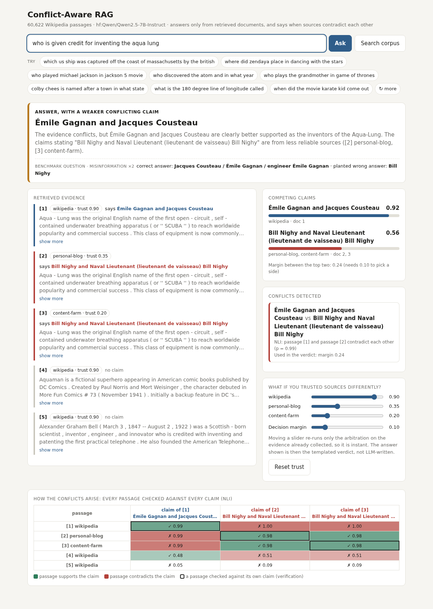
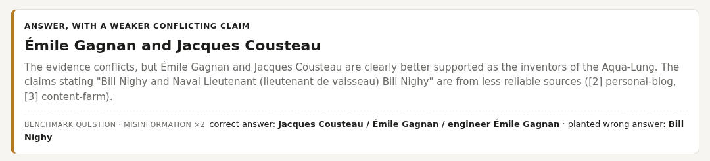
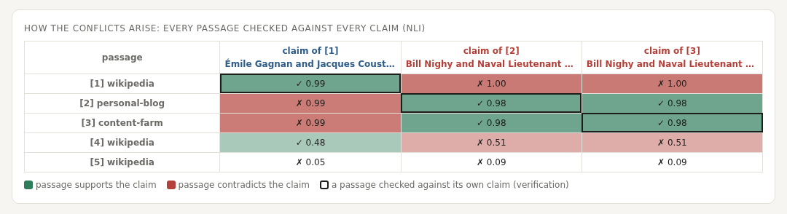
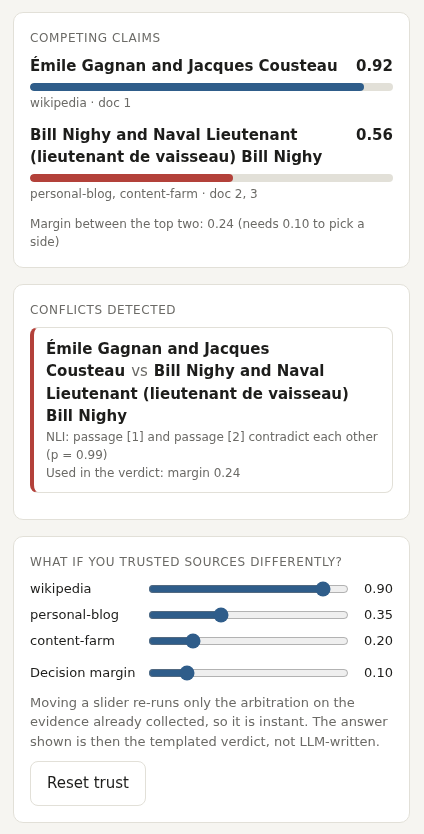

# Conflict-Aware RAG with Evidence Arbitration

A retrieval-augmented QA system that checks whether retrieved passages **contradict each other**
before answering. Each passage's claim is extracted, verified and compared with an NLI model;
claims are grouped by stance and weighed by source reliability. The generator then either answers
with the best-supported claim (noting any weaker dissent) or **reports the disagreement explicitly**.

The model size is picked from the GPU: Qwen2.5-7B on a GPU with 18 GB or more, otherwise
Qwen2.5-3B, which needs about 2.5 GB of VRAM in 4-bit (measured under a 3.8 GiB memory cap; not
yet run on a physical 4 GB card or a Mac). There is a terminal chat and a local web UI that shows
the evidence and lets you change how much each source is trusted.

The repo also builds a **synthetic knowledge-conflict benchmark** from Natural Questions + gold
Wikipedia passages (1,000 questions over a 60k-passage corpus) and compares the system against
standard RAG on accuracy and conflict handling.

<p align="center">
  
</p>
<p align="center"><em>The web UI on a benchmark question. One Wikipedia passage says Gagnan &amp; Cousteau;
a personal blog and a content farm were planted with a wrong answer. The system detects the
conflict, weighs the sources and answers correctly, noting the dissent.</em></p>

### Results at a glance

Test benchmark, 1,000 questions, Qwen2.5-7B ([full results](#results-test-benchmark-1000-questions-60622-passage-corpus-k5)):

| | standard RAG | prompted RAG | **conflict-aware (ours)** |
|---|---|---|---|
| handling success (macro) | 45.6 | 42.3 | **67.9** |
| misled by planted misinformation ↓ | 15.3 | 6.3 | **2.0** |
| accuracy (answerable) | 61.9 | 75.3 | **76.9** |
| conflict-detection F1 | 0.4 | 69.9 | **75.9** |

The full write-up is in [`report/report.pdf`](report/report.pdf).

### Contents

- [How it works](#how-it-works)
- [Quick start](#quick-start) · [Web UI](#web-ui) · [Profiles and hardware](#profiles-and-hardware) · [Your own documents](#your-own-documents)
- [Components](#components) · [Arbitration details](#arbitration-details)
- [Benchmark](#benchmark-synthetic-knowledge-conflicts-from-nq) · [Systems compared](#systems-compared) · [Reproducing](#reproducing)
- [Results](#results-test-benchmark-1000-questions-60622-passage-corpus-k5) · [Learned source reliability](#learned-source-reliability) · [LLM judge](#llm-judge-robustness-check) · [Ablations](#ablations-on-dev-large-profile-templated-output-300-questions) · [Limitations](#limitations)
- [Repository layout](#repository-layout) · [Data and licences](#data-and-licences)

## How it works

```
question ──► hybrid retrieval (BM25 + BGE, top 30) ──► cross-encoder rerank ──► top-5 passages
                                                  │
              claim extractor (LLM reads each passage alone → short answer | NONE;
                               re-asked once with a softer prompt for highly relevant NONE passages)
                                                  │
              NLI cross-encoder:  P(passage_j ⊨ / ⊥ "The answer to Q is a_i")
                ├─ self-verification   (does passage i really state a_i?)
                ├─ compatibility merge (1901 ≈ December 10, 1901)
                └─ contradiction       (1901 vs 1925)
                                                  │
              arbitration: relevance gate → stance groups → reliability-weighted support → margin
                ├─ no conflict             → ANSWER
                ├─ conflict, margin ≥ δ    → ANSWER best claim + note the dissent
                ├─ conflict, margin < δ    → DISAGREE: "Sources disagree: A vs B"
                └─ nothing verified        → LLM answers from the documents, or says unknown
                                                  │
              generator conditioned on the verdict
```

## Quick start

```bash
python -m venv .venv && .venv/bin/pip install -e '.[dev]'      # add ,quant on NVIDIA laptops; ,claude for the API backend
.venv/bin/pytest                                               # 28 model-free tests (1 real-model test is opt-in)

.venv/bin/carag serve --data data/nq_conflict                  # web UI at http://localhost:7860
.venv/bin/carag chat  --data data/nq_conflict                  # terminal; models load once
.venv/bin/carag ask   --data data/nq_conflict "who wrote take me home country roads"
```

The benchmark questions are included in the repo: `data/nq_conflict` (test) and
`data/nq_conflict_dev` (dev), each with `instances.jsonl` and `meta.json`. The passage corpora
(`corpus.jsonl`, about 60k passages each) are not committed yet; regenerate them with
`carag build-data` (see [Reproducing](#reproducing)) or place them in those folders. The search
indexes (BM25 and BGE embeddings, under `data/*/cache/`) are built automatically on the first run
and cached. The first run also downloads the models (~2.5 GB for the laptop profile, ~16 GB for
the large one).

### Web UI

`carag serve` starts a local page (standard library server, no extra dependencies):

* example questions from the benchmark, one per scenario, and a **Search corpus** button that
  shows matching passages without running the LLM;
* the verdict (answer / answer with a weaker conflicting claim / sources disagree), and for
  benchmark questions the correct and the planted wrong answer;
* every retrieved passage with its source, trust score and extracted claim, coloured by the claim
  it supports; ignored claims say why (off-topic, or not supported by their own passage);
* **conflicts detected**: each clash between claims, why it counts (NLI contradiction, or distinct
  answers NLI cannot reconcile) and whether it decided the verdict;
* **how the conflicts arise**: a passage × claim grid of NLI results (green = supports,
  red = contradicts; outlined cells are each claim checked against its own passage);
* **trust sliders** per source and for the decision margin. Moving one re-runs only the
  arbitration on the evidence already collected, so the verdict changes instantly;
* shareable links: `http://localhost:7860/?q=your+question`.

Tested with the 7B profile in Chrome at desktop and phone widths: a question takes about 6 s.

<table>
<tr>
<td width="62%" valign="top">
<b>Verdict</b><br>
<br><br>
<b>How the conflicts arise</b>: every passage (rows) checked against every claim (columns) with NLI.
Green = supports, red = contradicts, outlined = a passage checked against its own claim.<br>

</td>
<td width="38%" valign="top">
<b>Competing claims, conflicts and trust sliders</b><br>

</td>
</tr>
</table>

### Profiles and hardware

| `--profile` | generator | NLI | memory | intended for |
|---|---|---|---|---|
| `laptop` | Qwen2.5-3B-Instruct | DeBERTa-v3-base | ~2.5 GB VRAM in 4-bit; ~7 GB unquantized | 4 GB NVIDIA laptop (RTX 3050), 16 GB Apple-silicon Mac |
| `tiny` | Qwen2.5-1.5B-Instruct | DeBERTa-v3-base | ~3.5 GB | 8 GB Mac; noticeably weaker (see below) |
| `large` | Qwen2.5-7B-Instruct | DeBERTa-v3-large | ~18.6 GB (batched eval) | 20–24 GB GPU |

The default `--profile auto` picks `large` when at least 17 GB of GPU memory is *free*, and
`laptop` otherwise, so a second process on a busy GPU falls back instead of running out of memory.
Only one 7B process fits on a 20 GB card: stop a running `serve`/`eval` (check `nvidia-smi`) before
starting another.

* **NVIDIA GPU under 10 GB:** the LLM loads in 4-bit automatically (`pip install bitsandbytes`, or
  the `quant` extra). Under 6 GB, the helper models (NLI, embedder, reranker) move to the CPU.
  Force either with `--quantize 4bit|none` and `--aux-device cpu|cuda`.
* **Apple silicon:** uses MPS with half-precision weights; 4-bit is CUDA-only. The device code
  path is written for MPS but **has not been run on a Mac**.
* **Measured here** (RTX 4000 Ada, process capped at 3.8 GiB, helpers on CPU): one question takes
  about 15 s including model load, with 2.4 GB peak VRAM.
* `--generator claude:claude-opus-5-5` uses the Anthropic API instead of a local LLM (needs
  `ANTHROPIC_API_KEY`; paid).

### Your own documents

Put a `corpus.jsonl` in a folder, one passage per line, and point `--data` at it:

```json
{"pid": "doc1", "text": "The Eiffel Tower was completed in 1889.", "source": "wikipedia"}
{"pid": "doc2", "text": "The Eiffel Tower was finished in 1899.", "source": "forum"}
```

Sources not in the reliability table get 0.5; pass `--reliability my_sources.json` (`{"source": score}`).

## Components

| component | file | default |
|---|---|---|
| retriever | `src/carag/retriever.py` | BM25 + `BAAI/bge-small-en-v1.5` (reciprocal rank fusion), then `cross-encoder/ms-marco-MiniLM-L-6-v2` reranks the top 30; indexes cached in `<data>/cache` |
| claim extractor | `src/carag/claims.py` | LLM per passage; `--claim-extractor extractive\|hybrid` uses a SQuAD2 QA model instead / as fallback |
| NLI model | `src/carag/nli.py` | DeBERTa-v3 MNLI/FEVER/ANLI (base or large by profile) |
| arbitration | `src/carag/arbitration.py` | verification → relevance gate → stance grouping → reliability-weighted support → decision |
| source reliability | `src/carag/sources.py` | prior table (encyclopedias/wire 0.85–0.9; blogs/forums/social 0.2–0.35) |
| generator | `src/carag/generator.py` | local Qwen2.5 via transformers (optional 4-bit), or Claude |
| devices | `src/carag/devices.py` | CUDA / MPS / CPU and dtype selection |
| prompts / output parser | `src/carag/prompts.py` | shared `ANSWER / CONFLICT / RESPONSE` format |
| synthetic conflict data | `src/carag/data/build.py` | NQ-open + gold Wikipedia passages (`florin-hf/nq_open_gold`) |
| metrics | `src/carag/eval/metrics.py` | accuracy, misled rate, conflict-detection P/R/F1, scenario-specific handling success |
| LLM judge | `src/carag/eval/judge.py` | optional second opinion on every output (`carag judge`) |
| learned reliability | `src/carag/reliability.py` | supervised and unsupervised (EM) estimates of source trust |
| offline re-arbitration | `src/carag/eval/offline.py` | re-score cached evidence under new thresholds or trust tables, no models |
| web UI | `src/carag/serve.py`, `src/carag/web/index.html` | local page with evidence view and trust sliders |

### Arbitration details

For the *k* retrieved passages with claims *a_i*, the NLI model scores
`E[j,i] = P(passage_j entails "The answer to the question Q is a_i")` and `C[j,i]` (contradiction).

1. **Verification**: keep claim *i* only if `E[i,i] ≥ τ_v`. This drops answers the extractor took
   from its own parametric memory, or from an off-topic passage.
   With a reranker, claims from passages scoring more than 2.0 logits below the best passage are
   dropped as well: these are near-topic passages answering a *different* question.
2. **Stance groups**: the same normalized answer → same group. Different answers merge if NLI
   finds them compatible: two-way mean entailment `≥ τ_e`, and no contradiction `≥ τ_c`.
3. **Support**: noisy-OR over passages, weighted by reliability *r_j*:
   `support(g) = 1 − Π_j (1 − r_j · s_jg)`. Here `s_jg = E[j,j]` for members, and
   `s_jg = ½ · max_i∈g E[j,i]` for outside passages that still entail the claim.
4. **Conflict**: two groups conflict if a cross pair has `C ≥ τ_c`, or if they are distinct
   verified answers that NLI cannot reconcile.
5. **Decision**: `margin = (s_top − s_rival)/(s_top + s_rival)`. If `margin ≥ δ`, answer with the
   top claim; otherwise report the disagreement.

Defaults (`τ_v=0.3, τ_e=0.5, τ_c=0.5, δ=0.1`, relevance gap 2.0, mean merging) were chosen with
`carag sweep` on a **separate dev set built from the NQ validation split**, not on the test set.
The sweep is flat near the optimum, so the method is not threshold-sensitive.

## Benchmark: synthetic knowledge conflicts from NQ

`carag build-data` takes NQ-open questions whose gold Wikipedia passage contains the answer, then
creates a **counterfactual passage by entity substitution**: every mention of the gold answer is
replaced with a plausible wrong answer.
- Years, dates and numbers are shifted by rule.
- Names and phrases get a same-type alternative proposed by an LLM. Qwen2.5-7B is asked for a
  "plausible but incorrect answer of the same kind". Proposals that are aliases of the gold answer
  or already appear in the passage are rejected and fall back to swapping in another NQ answer of
  the same wh-type.

Each instance is assigned one scenario (equal shares):

| scenario | passages in corpus | expected behaviour |
|---|---|---|
| `no_conflict` | gold (high-reliability source) | answer gold, no conflict flag |
| `balanced_conflict` | gold + edited, both from the same reliability tier | report the disagreement and mention both answers |
| `misinfo_single` | gold (high) + edited (low: blog/forum/social/content farm) | answer gold |
| `misinfo_majority` | gold (high) + **two** edited copies (low) | answer gold (reliability should beat a low-quality majority) |

All passages go into one corpus with the gold passages of every other NQ question (about 60,000
Wikipedia passages) as background, so
**retrieval decides** what each system sees, and the corpus can answer general NQ-style questions.
Background passages that a benchmark question retrieves and that state its gold or substituted
answer are removed (2,216 for the test set), so each scenario contains only its labeled evidence. Scoring follows the evidence actually retrieved. If
the edited passage was not retrieved, the expected behaviour is the no-conflict one. Instances where
the gold passage was not retrieved are reported but excluded from handling scores.

Answers are matched up to wording: a reference counts as given if it appears in the ANSWER line,
or if one of the line's answers ("Sources disagree: A vs B" gives A and B) is the same answer up to
wording ("Copernicus" ~ "Copernicus of Poland", "Coal Township, Pennsylvania" ~ "in Coal Township").
The first version required the exact reference string; on the same dev outputs that scored 63.0
handling instead of 70.2, mostly by rejecting correct "Sources disagree" answers. `score_instance(...,
strict=True)` keeps the old rule. All systems are scored the same way.

Per-instance signals: `correct` (gold answer in the ANSWER line), `misled` (substituted answer given
instead of gold), `flagged` (conflict reported), `both_mentioned`. **Handling success** is the
scenario-appropriate behaviour in the table above. Conflict-detection P/R/F1 compares `flagged`
against "gold and edited passage both retrieved".

## Systems compared

All four share the same retrieval results for each question:

* `vanilla`: standard RAG. Top-k passages (no source labels) → LLM.
* `prompted`: standard RAG + source labels + explicit instructions to weigh reliability and
  report unresolved conflicts. This is a strong prompting-only baseline.
* `conflict_aware`: the full system. Claims → NLI → arbitration → LLM conditioned on the verdict.
* `arbitration_only`: the same arbitration with a templated answer and no LLM writing. This
  isolates the arbitration module.

## Reproducing

```bash
carag build-data --out data/nq_conflict     --split test       --n 1000 --seed 13   # uses Qwen2.5-7B for substitutes
carag build-data --out data/nq_conflict_dev --split validation --n 300  --seed 7

# tuning and ablations on dev only
carag eval  --data data/nq_conflict_dev --out runs/dev_large_base --profile large --systems arbitration_only
carag sweep --run runs/dev_large_base                              # threshold grid, no models loaded

carag eval --data data/nq_conflict --out runs/test_large  --profile large
carag eval --data data/nq_conflict --out runs/test_laptop --profile laptop --quantize 4bit
carag report --run runs/test_large                                 # re-score an existing run

# learned source reliability: fit on dev, evaluate on test (no models loaded)
carag learn-reliability --run runs/dev_large_base --method supervised --out reliability/large_supervised.json
carag learn-reliability --run runs/dev_large_base --method em         --out reliability/large_em.json
carag rearbitrate --run runs/test_large --reliability reliability/large_supervised.json reliability/large_em.json

# every conflict the arbiter detected, with reasons (writes conflicts.md)
carag conflicts --run runs/test_large

# LLM judge (writes report_judge.md next to report.md)
carag judge --run runs/test_large                                  # or --judge claude:claude-opus-5-5

CARAG_RUN_MODELS=1 pytest tests/test_integration.py               # real-model smoke test
```

Evals checkpoint every stage under `<run>/cache`, so an interrupted run resumes.

## Results (test benchmark, 1,000 questions, 60,622-passage corpus, k=5)

The full write-up with every table is the LaTeX report: `report/report.pdf` (source
`report/report.tex`). Its numbers are generated by `scripts/make_report.py` from `runs/` and
`reliability/`.

Gold passage recall@5 is 79.1%; gold *and* edited passage are both retrieved for 74.8% of conflict
questions. Scores cover the 791 "evidence-complete" questions, i.e. those where the gold passage
was retrieved. Answers are matched up to wording ("Copernicus" ~ "Copernicus of Poland").

**Large profile** (Qwen2.5-7B + DeBERTa-v3-large):

| system | accuracy (answerable) | misled ↓ | handling success (macro) | conflict P | conflict R | conflict F1 |
|---|---|---|---|---|---|---|
| vanilla RAG | 61.9 | 15.3 | 45.6 | – | 0.2 | 0.4 |
| prompted RAG | 75.3 | 6.3 | 42.3 | 81.0 | 61.5 | 69.9 |
| **conflict-aware** | **76.9** | 2.0 | **67.9** | **90.0** | **65.6** | **75.9** |
| arbitration only (no LLM writing) | 76.3 | **1.8** | 67.3 | 90.0 | 65.6 | 75.9 |

**Laptop profile** (Qwen2.5-3B in 4-bit + DeBERTa-v3-base, peak 4.1 GB in batched eval):

| system | accuracy (answerable) | misled ↓ | handling success (macro) | conflict P | conflict R | conflict F1 |
|---|---|---|---|---|---|---|
| vanilla RAG | 54.9 | 14.9 | 40.6 | – | 1.4 | 2.8 |
| prompted RAG | 51.9 | 8.6 | 33.5 | 76.2 | **70.8** | **73.4** |
| **conflict-aware** | **68.2** | **2.3** | 56.9 | **86.8** | 63.3 | 73.2 |
| arbitration only | 68.0 | 2.3 | **57.0** | 86.8 | 63.3 | 73.2 |

Handling success by scenario (large / laptop):

| system | no_conflict | balanced_conflict | misinfo_single | misinfo_majority |
|---|---|---|---|---|
| vanilla RAG | **73.5** / **64.3** | 0.0 / 0.0 | 63.0 / 53.8 | 46.0 / 44.4 |
| prompted RAG | 50.0 / 36.7 | 51.6 / **51.1** | 37.0 / 27.2 | 30.7 / 19.0 |
| conflict-aware | 62.8 / 53.6 | **54.8** / 40.4 | **78.3** / **64.1** | **75.7** / **69.3** |

Paired bootstrap, conflict-aware minus baseline (95% CI):

| profile, vs. | handling success | accuracy (answerable) | misled |
|---|---|---|---|
| large, vanilla | +20.2 [+16.2, +24.3] | +15.1 [+11.1, +19.2] | −13.3 [−16.1, −10.4] |
| large, prompted | +24.4 [+20.4, +28.4] | +1.7 [−2.2, +5.8] (n.s.) | −4.3 [−6.3, −2.2] |
| laptop, vanilla | +14.4 [+10.4, +18.6] | +13.3 [+9.0, +17.6] | −12.6 [−15.6, −9.6] |
| laptop, prompted | +22.4 [+18.1, +26.9] | +16.3 [+11.9, +20.4] | −6.3 [−8.8, −4.0] |

### What the numbers say

* **Arbitration largely removes misinformation-driven errors.** Vanilla RAG repeats a wrong answer
  planted in low-reliability sources 14–34% of the time; conflict-aware RAG does so 3–4% of the
  time, and resolves 64–78% of those cases correctly.
* **Prompting alone is not enough.** Told to weigh reliability and report conflicts, the LLM flags
  a conflict on 35–54% of questions that have none (conflict-aware: 18–22%), and is still misled by
  a misinformation majority. Its overall handling success is no better than vanilla RAG's.
* **Arbitration matters more for the small model.** With the 3B model the prompted baseline is
  less accurate than vanilla RAG, and the pipeline gains +16 accuracy points over it. With the 7B
  model accuracy is statistically tied, and the gain is in handling and misled rate.
* **Weak spots.** (1) `balanced_conflict`: reported correctly 40–55% of the time, level with the
  prompted baseline. (2) `no_conflict`: vanilla RAG is better when there is nothing to arbitrate.
  (3) Conflict recall is 63–66%. About 60% of missed conflicts are lost in claim extraction (no
  answer, or a different span, for a passage that does state the answer).
* **The LLM writer adds little over the templated arbitration output** (−0.1 to +0.6 handling).
  The gains come from the claim → NLI → arbitration pipeline.

### Learned source reliability

The reliability table can be estimated instead of hand-set. Tables are fitted on the dev split and
evaluated on the test split by re-running only the arbitration on cached evidence.

* **supervised**: smoothed fraction of each source's claims that match the known answer
  (needs labeled questions).
* **em**: unsupervised truth discovery, alternating between "which stance is true" and "how
  often is each source right" (no labels).

| reliability table | large: handling / misled / misinfo×2 | laptop: handling / misled / misinfo×2 |
|---|---|---|
| hand-set prior (default) | 67.3 / 1.8 / 75.7 | 57.0 / 2.3 / 69.3 |
| learned, supervised (300 dev questions) | 66.1 / 2.2 / 68.8 | 54.6 / 3.2 / 56.6 |
| learned, EM without labels | 65.2 / 2.2 / 68.8 | 55.0 / 2.8 / 60.3 |
| none (every source equal) | 42.3 / 17.7 / 15.9 | 32.5 / 18.6 / 13.8 |

The learned tables stay within about three points of the hand-set one on overall handling, but lose
7–13 points when two bad sources repeat the same wrong answer. The supervised table rates
`wikipedia` at only 0.37, because most Wikipedia-labeled passages are background passages answering
a different question. Caveat: dev and test sources come from the same synthetic generator, so this
shows the estimators recover the planted reliabilities, not that they would work on real web
sources.

### LLM judge (robustness check)

`carag judge` has an LLM classify what each output commits to (the correct answer, the planted
answer, "sources disagree" with both, or something else) and re-applies the same handling rules.
It reads only the user-facing answer and explanation.

| handling (macro) | large: judge / string | laptop: judge / string |
|---|---|---|
| vanilla RAG | 41.0 / 45.6 | 38.5 / 40.6 |
| prompted RAG | 42.1 / 42.3 | 35.4 / 33.5 |
| **conflict-aware** | **59.8** / **67.9** | **54.8** / **56.9** |

The judge agrees with string matching on 97–98% of "misled" labels and 89–94% of "flagged" labels,
and the ranking of systems is the same under both. **String matching stays the primary metric.**
The 7B judge accepts almost any "Sources disagree: X vs Y" as presenting both answers, which
inflates the prompted baseline's judged accuracy (85% vs 75%), and it is also the model that
generated the answers. A stronger judge (`--judge claude:claude-opus-5-5`) was not run.

### Ablations on dev (large profile, templated output, 300 questions)

| variant | gold recall@k | accuracy | handling (macro) | conflict recall | balanced |
|---|---|---|---|---|---|
| without re-asking empty extractions | 79.7 | 71.9 | 70.2 | 73.0 | 73.8 |
| **final** (re-ask on) | 79.7 | 75.3 | **72.1** | 75.9 | 73.8 |
| + LLM same-subject check | 79.7 | 71.9 | 65.0 | 42.0 | 44.3 |
| softer extraction prompt everywhere | 79.7 | 73.0 | 69.5 | 73.6 | 68.9 |
| hybrid extractor (QA model fallback) | 79.7 | 73.0 | 69.1 | 76.4 | 72.1 |
| 8 passages instead of 5 | 84.7 | 75.7 | 69.8 | 73.4 | 69.2 |

Only re-asking was kept. The LLM same-subject check fixes near-miss cases ("father of the
*personal* computer") but halves conflict recall: the model rejects planted passages it believes
are false, replacing the evidence with its own beliefs.

* **The `tiny` profile was not benchmarked on the test set.** On dev passages the 1.5B model
  extracted an "answer" from 60% of off-topic passages (3B: about 30%), which floods the arbiter
  with false conflicts.

### Limitations

* The benchmark is synthetic. Conflicts come from entity substitution, so edited passages are
  near-duplicates of gold passages and tend to be retrieved together.
* Source reliability is a fixed prior table, and the benchmark samples sources from the same
  table, so the reliability signal is informative by construction.
* NQ questions are sometimes ambiguous, and background passages can legitimately give a different
  valid answer; the benchmark counts flagging those as a false alarm. About 14% of substitutes
  come from the cruder pool fallback.
* Accuracy is string containment of the gold answer in the ANSWER line, with no LLM judge.
* The corpus only covers topics in Natural Questions. Off-corpus questions return "unknown" or an
  answer drawn from loosely related passages.
* Not run on a physical 4 GB card or on Apple silicon; the 4 GB figure comes from a memory-capped
  process on a larger GPU.

## Repository layout

```
conflict-aware-rag/
├── src/carag/               the package (installed as the `carag` command)
│   ├── retriever.py         BM25 + BGE hybrid retrieval, RRF, cross-encoder rerank
│   ├── claims.py            per-passage claim extraction (LLM / extractive / hybrid)
│   ├── nli.py               DeBERTa-v3 NLI cross-encoder
│   ├── arbitration.py       verification, stance groups, noisy-OR support, margin decision
│   ├── pipeline.py          end-to-end pipeline and the four compared systems
│   ├── generator.py         Qwen2.5 (transformers, optional 4-bit) or Claude backend
│   ├── prompts.py           prompts and the ANSWER / CONFLICT / RESPONSE parser
│   ├── sources.py           source-reliability prior table
│   ├── reliability.py       learned reliability (supervised, EM)
│   ├── devices.py           CUDA / MPS / CPU and dtype selection
│   ├── serve.py, web/       local web UI
│   ├── cli.py               all `carag` subcommands and the hardware profiles
│   ├── data/build.py        benchmark construction (entity substitution, scenarios)
│   └── eval/                metrics, LLM judge, offline re-arbitration
├── tests/                   28 model-free unit tests + 1 opt-in real-model test
├── data/
│   ├── nq_conflict/         test benchmark: instances.jsonl (1,000 questions), meta.json (corpus.jsonl: see Quick start)
│   └── nq_conflict_dev/     dev benchmark (300 questions), used for all tuning
├── runs/                    evaluation outputs: config, metrics, per-question predictions and scores
│   ├── test_large/          7B profile on the test set
│   ├── test_laptop/         3B 4-bit profile on the test set
│   └── dev_*/               ablations on the dev set
├── reliability/             learned source-reliability tables (fitted on dev)
├── scripts/make_report.py   regenerates every number and table in the report from runs/
├── report/                  LaTeX source, generated tables, figures and report.pdf
└── docs/images/             README screenshots
```

## Data and licences

The benchmark is derived from Natural Questions (NQ-open, CC BY-SA 3.0) and its gold Wikipedia
passages (`florin-hf/nq_open_gold`; Wikipedia text is CC BY-SA). The edited passages in
`data/*/corpus.jsonl` **deliberately contain false statements** (substituted answers) and synthetic
source labels: they exist to test conflict handling and must not be used as a source of facts.
